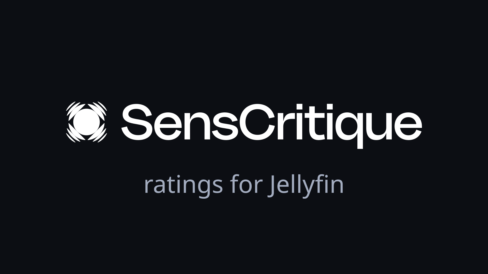

# Jellyfin SensCritique plugin



Replaces the community rating of movies and series with their
[SensCritique](https://www.senscritique.com) rating (out of 10). Every client
that shows Jellyfin's community rating picks it up, including Kodi through the
Jellyfin add-on, which stores it as Kodi's default rating.

Requires Jellyfin 12.

## Install

1. In the Jellyfin dashboard, Plugins, add a repository with this URL:

   ```text
   https://raw.githubusercontent.com/Aohzan/jellyfin-plugin-senscritique/main/manifest.json
   ```

2. Install SensCritique from the plugin catalog, then restart Jellyfin.

## Apply it to your libraries

The plugin has no setting: it applies to every movie and series, in every
library. New items get their SensCritique rating when they are added. Existing
items get it at their next metadata refresh: run Refresh metadata on a library
with "Search for missing metadata", or wait for the automatic refresh (Manage
library > Automatically refresh metadata from the internet). "Scan for new and
updated files" only refreshes new and changed items.

## Show the SensCritique symbol in the web client

Jellyfin draws a star next to the community rating. To show the SensCritique
symbol instead, paste the content of [`css/rating-icon.css`](css/rating-icon.css)
in Dashboard > General > Custom CSS. It applies to the clients built on the web
client (browsers, Jellyfin Media Player, the Android app). Kodi and the native
apps (Android TV, Swiftfin) draw their own star.

## Fix a match

Items without a match keep the rating of the metadata downloaders (TMDb) and
are logged at Information level: `No SensCritique match for <name> (<year>)`.
To set or correct the match of an item, enter its SensCritique id (the number
at the end of its senscritique.com URL) in the metadata editor, under External
IDs, then refresh its metadata with "Search for missing metadata". The
SensCritique link of an item opens the matched work.

## How it works

The plugin is a custom metadata provider for movies and series. Jellyfin runs
it after the metadata downloaders (TMDb, OMDb) have filled the item, on every
refresh that runs the providers: a new item, "Search for missing metadata",
"Replace all metadata" and the automatic refresh. It sets the community rating
and a SensCritique id, and leaves every other field to the downloaders. When
SensCritique has no match, or the work has no rating yet, the downloaders'
rating is kept.

Finding the SensCritique work:

1. An item that already has a SensCritique id, from an earlier match or set by
   hand, is looked up by id. Its rating is refreshed and the match is kept.
2. Otherwise the plugin searches SensCritique by original title, then by name,
   as the downloaders identified them, among movies or series. A result matches when its French or original title
   equals one of the item's titles, ignoring case, accents, punctuation and a
   trailing parenthesized part such as "(US)", and when one of its years
   (production, release) is within 1 year of the item's, or 3 for series
   (SensCritique often dates a series by its French release). The closest year
   wins, then the most rated work. Movies without a year are not matched.

On a library of 452 movies and 39 series, 481 items matched, including all 189
that Wikidata links to a SensCritique id, and no match was wrong. The others
were concerts and TV documentaries that SensCritique does not list, and titles
it writes differently ("Dead Reckoning" for "Dead Reckoning Part One").

## Limitations

- SensCritique has no public API. The plugin uses the GraphQL API behind the
  website (`apollo.senscritique.com`), one request at a time, 500 ms apart: it
  can break whenever SensCritique changes it.
- Seasons and episodes keep their rating.
- It cannot be turned off for a single library: Jellyfin has no per-library
  setting for custom providers.

## Disclaimer

This plugin is not affiliated with, endorsed or supported by SensCritique. It
reads ratings through the API of the SensCritique website, which is not public,
and will be taken down if SensCritique asks for it. The SensCritique name and
logo belong to their owner and only identify the service the ratings come from.

## Development

Tools come from `mise.toml`: `mise run install` (npm packages, NuGet packages,
git hooks), `mise run lint`, `mise run test`. Commits follow Conventional
Commits: merging to `main` releases a new version with semantic-release.

## License

[GPL-3.0](LICENSE)
